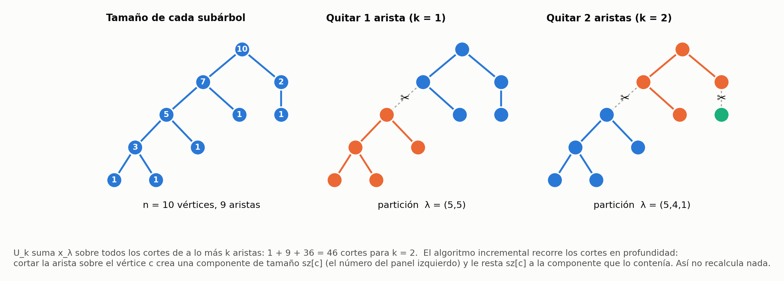
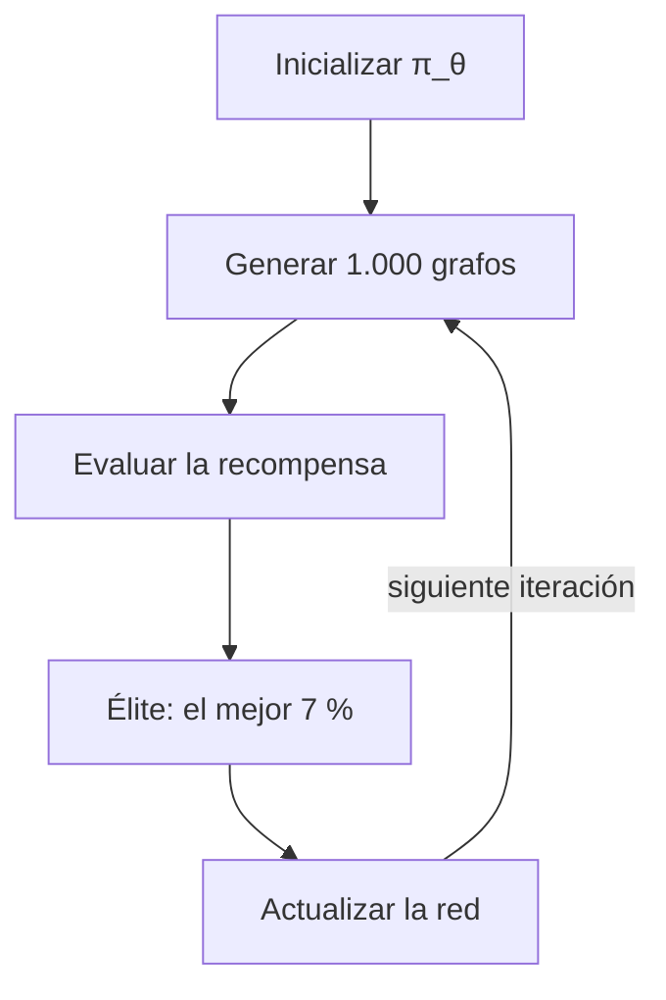
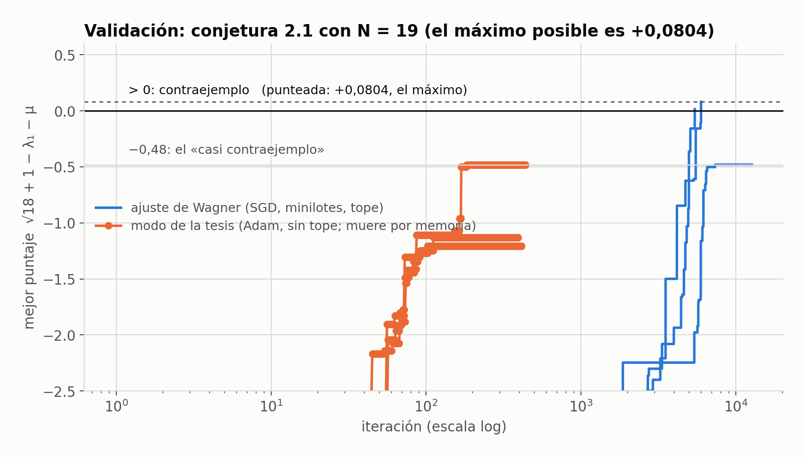
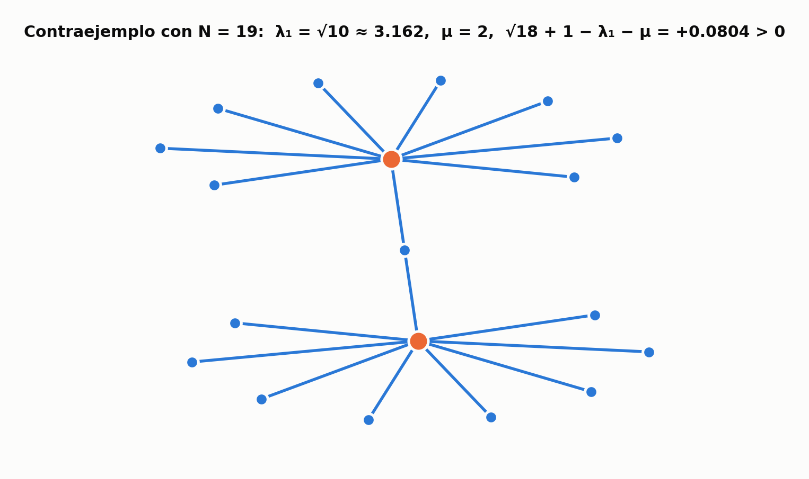
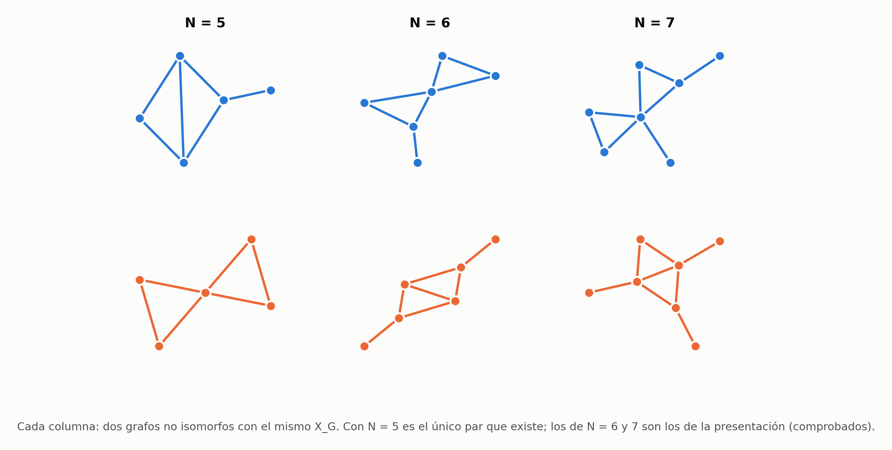
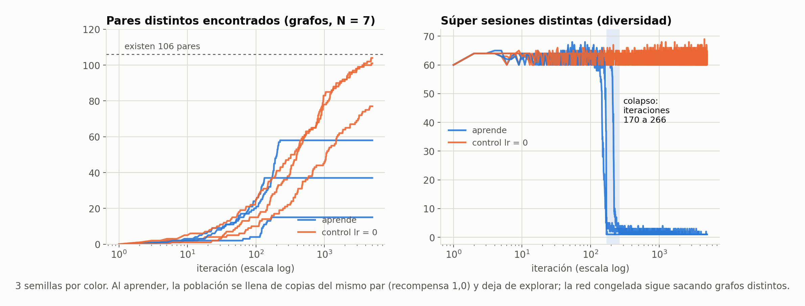
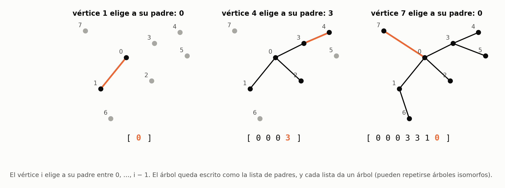
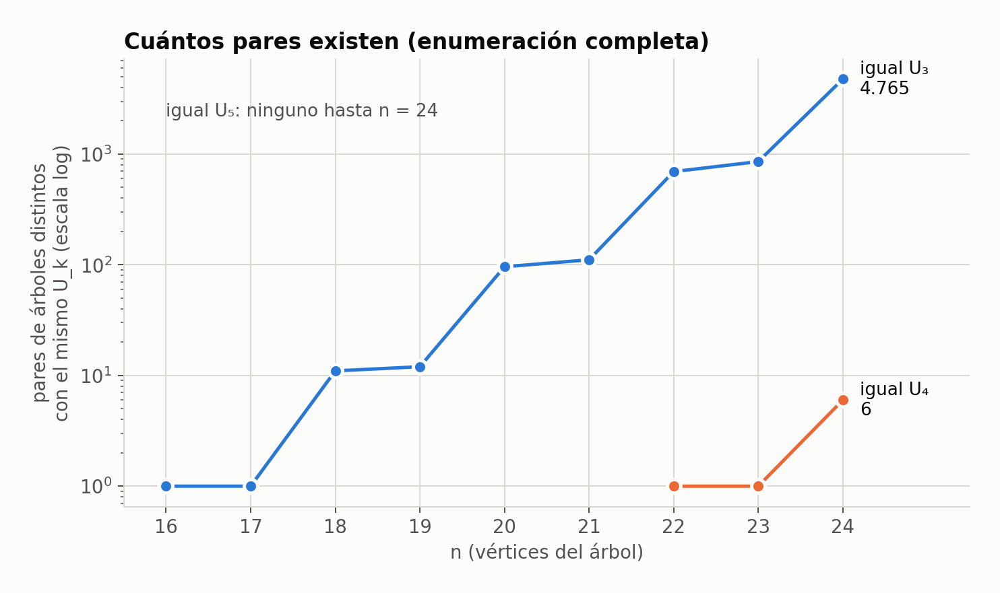

<h1 align="center">Aprendizaje reforzado para la búsqueda de contraejemplos<br>a la conjetura de Stanley (1995)</h1>

<p align="center">
  <b>Benjamín Campos</b> · Profesores guía: Dr. José Aliste y Dr. Mauricio Duarte<br>
  Tesis de Licenciatura en Matemáticas · Universidad Andrés Bello
</p>

<picture>
  <source media="(prefers-color-scheme: dark)" srcset="figuras/readme/par-u4-n22-oscuro.png">
  
</picture>

## ¿De qué trata el trabajo?

**Objetivo:** buscar contraejemplos a la conjetura de Stanley (1995) sobre el isomorfismo de árboles.

| | |
|---|---|
| **Herramientas** | polinomio simétrico cromático, U-polinomio y aprendizaje reforzado |
| **Algoritmo** | el *Cross-Entropy* de Wagner (2021), reimplementado en PyTorch |
| **Meta** | pares de grafos y de árboles no isomorfos con el mismo polinomio |
| **Contribución** | recompensas y codificaciones para objetos combinatorios, medidas contra la verdad (todos los árboles hasta 24 vértices) |

> [!IMPORTANT]
> **En breve:** la réplica reproduce a Wagner y encuentra su contraejemplo de $N = 19$. En Stanley, el RL en el modo de la tesis no le gana a una red que no aprende: se queda pegado en el primer par. El par más chico con igual $U_5$ sigue abierto, entre 25 y 34 vértices, y ahí está la pregunta que importa.

**Contenido:** [1. Insumos](#1-insumos) · [2. Re-implementación](#2-re-implementación-en-pytorch-n--19) · [3. Grafos con ciclos](#3-pares-de-grafos-con-ciclos) · [4. Árboles](#4-pares-de-árboles) · [5. ¿Qué algoritmo encuentra cada k?](#5-qué-algoritmo-encuentra-los-pares-de-cada-k) · [6. Dificultades](#6-dificultades) · [7. Conclusiones](#7-conclusiones) · [8. Trabajos futuros](#8-trabajos-futuros) · [Cómo correrlo](#cómo-correrlo)

---

## 1. Insumos

### El U-polinomio de un árbol

Para cada subconjunto de aristas $A$, las componentes de $T|_A$ forman una partición $\lambda(A)$ de $n$. El U-polinomio (Noble y Welsh, 1999) las suma todas:

$$U_T = \sum_{A \subseteq E} x_{\lambda(A)}, \qquad x_{\lambda} = x_{\lambda_1} x_{\lambda_2} \cdots$$

<picture>
  <source media="(prefers-color-scheme: dark)" srcset="figuras/readme/u-polinomio-oscuro.png">
  
</picture>

En la base $(x_4,\ x_3x_1,\ x_2x_1^2,\ x_2^2,\ x_1^4)$ el camino da $[1,2,3,1,1]$ y la estrella $[1,3,3,0,1]$. En árboles, $U$ y el polinomio simétrico cromático $X_T$ guardan la misma información.

### La conjetura de Stanley (1995)

**Si dos árboles tienen el mismo $X_T$ (o el mismo $U$), son isomorfos.**

- Sigue abierta.
- Verificada hasta 29 vértices (Heil y Ji, 2019).
- Probada en familias, como las orugas (Loebl y Sereni, 2019) y las arañas (Martin, Morin y Wagner, 2008).

### El U truncado, $U_k$

Calcular $U$ entero cuesta $2^{n-1}$ subconjuntos. El truncado solo quita **a lo más $k$ aristas**. En la literatura se llama $U$ restringido (Aliste-Prieto, de Mier y Zamora, 2017).

<picture>
  <source media="(prefers-color-scheme: dark)" srcset="figuras/readme/uk-cortes-oscuro.png">
  
</picture>

**Lo clave del marco teórico:** para **todo** $k$ existen árboles distintos con el mismo $U_k$. Entonces un par con igual $U_k$ **no es** un contraejemplo. Lo que importa es desde qué $n$ aparece el primer par, $\Phi(k)$:

<picture>
  <source media="(prefers-color-scheme: dark)" srcset="figuras/readme/phi-k-oscuro.png">
  
</picture>

- Aliste-Prieto, de Mier y Zamora (2021) construyen pares $Y/Z$ con 7, 10, 16, 22, 34, … vértices (Teorema 12).
- Su **Conjetura 15** dice que esos son los más chicos. Si es cierta, Stanley es cierta (Prop. 16).
- Este repo midió los mínimos para $k$ de 1 a 4 enumerando todos los árboles, y calzan con $Y/Z$. Para $k = 5$ no hay pares hasta $n = 24$.
- **Un par con igual $U_5$ y menos de 34 vértices tumba la Conjetura 15.** Ese es el blanco.

### Aprendizaje reforzado y la idea de Wagner

- **Ambiente:** todos los grafos con $n$ vértices.
- **Agente:** una red neuronal (128-64-4) que construye el grafo paso a paso.
- **Recompensa:** depende de la conjetura que se quiere romper.
- **Entrenamiento:** *Cross-Entropy*. De 1.000 grafos se queda con el mejor 7 % y aprende a imitarlo.



---

## 2. Re-implementación en PyTorch (N = 19)

Wagner refutó con RL la conjetura 2.1 de su paper: $\lambda_1 + \mu \ge \sqrt{n-1} + 1$. La réplica usa PyTorch, Numba y Kaggle.

<picture>
  <source media="(prefers-color-scheme: dark)" srcset="figuras/readme/wagner-n19-oscuro.png">
  
</picture>

<picture>
  <source media="(prefers-color-scheme: dark)" srcset="figuras/readme/contraejemplo-n19-oscuro.png">
  
</picture>

- **Con el ajuste de Wagner** (SGD, minilotes de 32, élite con tope) llega a **+0,0804**, el máximo exacto: un contraejemplo real.
- **En el modo de la tesis** (Adam, élite sin tope) llega como mucho a **−0,48**. Es el mismo grafo de la lámina «Contraejemplo encontrado»: queda cerca, pero no cruza el cero. Además se queda sin memoria cerca de la iteración 400.

---

## 3. Pares de grafos con ciclos

**Idea:** la red arma **dos grafos** arista por arista (un vector binario de $\binom{N}{2}$ entradas). Cada par recibe

$$R = \frac{1}{1 + d\big(v(G_1),\, v(G_2)\big)},$$

donde $v(G)$ es el vector de $X_G$ y $d$ es la distancia entre los dos vectores. Si los grafos son isomorfos o alguno no es conexo, $R = -10^6$. El algoritmo busca $R \to 1$.

<picture>
  <source media="(prefers-color-scheme: dark)" srcset="figuras/readme/pares-grafos-oscuro.png">
  
</picture>

| | $N = 5$ | $N = 6$ | $N = 7$ |
|---|---|---|---|
| Pares que existen | 1 | 9 | 106 |
| Encuentra el RL (3 semillas) | 1 | 8, 7 y 9 | 58, 37 y 15 |
| Red sin aprender (`lr = 0`) | — | 9, 9 y 9 | 104, 101 y 77 |

**Por qué se estanca:** cuando encuentra un par, su recompensa vale 1,0. La red aprende a repetirlo hasta que toda la élite es el mismo par.

<picture>
  <source media="(prefers-color-scheme: dark)" srcset="figuras/readme/colapso-oscuro.png">
  
</picture>

---

## 4. Pares de árboles

**Idea:** lo mismo, pero con árboles y $U_k$ en vez del polinomio completo. Se usa *Cross-Entropy* categórico.

**Codificación del árbol:** el vértice $i$ elige a su padre entre $0, \dots, i-1$. La red da una probabilidad para cada padre posible.

<picture>
  <source media="(prefers-color-scheme: dark)" srcset="figuras/readme/codificacion-oscuro.png">
  
</picture>

**Recompensa:** $R = 1/(1 + \lVert U_k(T_1) - U_k(T_2) \rVert_2)$, y $-10^6$ si los árboles son isomorfos.

| | Presentación | Réplica |
|---|---|---|
| $N = 12$, $k = 3$ | par a distancia 16,6 | **√6 ≈ 2,449**, el mínimo exacto, en 3 de 3 semillas |
| $N = 24$, $k = 3$ | par a distancia 236,6 | 15,7 (RL) y 7,6 (sin aprender); ningún par, aunque existen **4.765** |
| $N = 24$, $k = 4$ | par a distancia 669,7 | 19,2 (RL) y 28,5 (sin aprender); ningún par, aunque existen **6** |

<picture>
  <source media="(prefers-color-scheme: dark)" srcset="figuras/readme/pares-por-n-oscuro.png">
  
</picture>

---

## 5. ¿Qué algoritmo encuentra los pares de cada k?

Los 4 métodos tienen el mismo presupuesto: 6 millones de árboles.

- **RL de Wagner** en el modo de la tesis.
- **Red sin aprender** (`lr = 0`): el mismo algoritmo con los pesos congelados. Si el RL no le gana, lo que encuentra lo habría encontrado igual.
- **Azar uniforme de a pares:** la probabilidad exacta de sacar el par al azar.
- **Azar con memoria:** cada árbol nuevo se compara con **todo** el historial, no solo con su pareja. Para ir rápido, el script reconoce los pares con la verdad de terreno; un detector a ciegas da el mismo resultado.

<picture>
  <source media="(prefers-color-scheme: dark)" srcset="figuras/readme/metodos-k3-oscuro.png">
  
</picture>

| | $k = 3$, $n \le 18$ | $k = 3$ y $4$, $n = 24$ | $k = 5$, $n$ de 25 a 33 |
|---|---|---|---|
| **RL (modo tesis)** | solo $n = 16$, en 2 de 10 semillas | ninguno | sin probar |
| **Azar con memoria** | todos, 10 de 10 | sin probar | no alcanza: con $n = 33$ hay 3·10¹¹ árboles |
| **Enumeración completa** | todos | todos (64 min en Kaggle) | ~4,7·10¹¹ árboles: pendiente, en el NLHPC |

Con $n \le 18$ hay pocos árboles (123.867 con $n = 18$), así que el azar tiene ventaja. Aun así muestra que comparar solo los dos árboles de cada sesión limita la búsqueda.

---

## 6. Dificultades

- **Codificación:** en vez de Prüfer inversa se usa la lista de padres, que siempre da un árbol válido.
- **Escalabilidad:** $U_k$ se calcula ahora cortando aristas en profundidad y llevando los tamaños de las componentes. Con $n = 34$ y $k = 5$ baja de 42–61 ms a 3,6 ms por árbol.
- **Colapso:** la élite se llena de copias del primer par encontrado y deja de explorar.
- **Piso de √2:** dos vectores $U_k$ distintos están a distancia √2 o más. Estar «cerca» no quiere decir estar cerca de un par.
- **Memoria:** sin tope, la élite crece a más de 20.000 sesiones con los empates y el proceso muere.

## 7. Conclusiones

1. **El método de Wagner se reproduce** ($N = 19$, +0,0804), pero solo con su ajuste.
2. **En el modo de la tesis, aprender no ayuda:** en grafos y en árboles la red sin aprender encuentra lo mismo o más.
3. **Un par con igual $U_k$ no es un contraejemplo.** La pregunta útil es si hay un par con igual $U_5$ y menos de 34 vértices.
4. **Hasta $n = 24$, enumerar le gana al RL.** El RL tiene sentido donde la enumeración no llega.

## 8. Trabajos futuros

- [ ] H3 con el ajuste de Wagner y reinicio cuando la población colapsa (30 semillas, $n$ = 18–20)
- [ ] «Wagner con memoria»: una sesión = un árbol, comparado con todo el historial
- [ ] Otros métodos de búsqueda: tabú, recocido simulado, NRPA
- [ ] Enumerar $U_5$ con $n$ de 25 a 33 en el cluster (NLHPC)
- [ ] Atajo con árboles de dos centroides y tablas de mitades
- [ ] Explicar la diferencia con Smith, Smith y Tian en $n = 23$

El detalle de cada hipótesis está en [`docs/hipotesis.md`](docs/hipotesis.md). La revisión de literatura está en [`docs/literatura_alternativas.md`](docs/literatura_alternativas.md) y el diario de trabajo en [`BITACORA.md`](BITACORA.md).

---

## Cómo correrlo

```bash
pip install -r requirements.txt
python -m pytest tests                                                   # 66 tests, sin redes neuronales
python scripts/verdad_terreno/colisiones.py arboles --n 10 16 --k 2 3    # pares que existen, en segundos
python scripts/verdad_terreno/azar_con_memoria.py . 101,102 azar.json    # azar con memoria, n = 16-18
python scripts/figuras_readme.py                                         # regenera las figuras de este README
```

Los entrenamientos con redes corren en Kaggle: `python kaggle/lanzar.py --lote humo` y `python kaggle/bajar.py --lote humo`. Cada kernel clona el repo en un commit fijo, que queda en su `estado.json`.

```
stanley_rl/          Enfoques 1 y 2, U-polinomio (Numba), red y Cross-Entropy
tests/               66 tests
scripts/             verdad de terreno, azar con memoria, figuras, validación de Wagner
kaggle/              lanzar y bajar lotes
resultados/          verdad de terreno y salidas de Kaggle
docs/                hipótesis, literatura y notas
CAMBIOS_VS_WAGNER.md cada diferencia con el código de Wagner, numerada
wagner_original/     copia sin modificar del repo de Wagner
```

## Referencias

- R. P. Stanley, *A symmetric function generalization of the chromatic polynomial of a graph*, Adv. Math. 111 (1995).
- S. D. Noble y D. J. A. Welsh, *A weighted graph polynomial from chromatic invariants of knots*, Ann. Inst. Fourier 49 (1999).
- J. Aliste-Prieto, A. de Mier y J. Zamora, *On trees with the same restricted U-polynomial and the Prouhet–Tarry–Escott problem*, Discrete Math. 340 (2017), arXiv:1509.09210.
- J. Aliste-Prieto, A. de Mier y J. Zamora, *On the smallest trees with the same restricted U-polynomial and the rooted U-polynomial*, Discrete Math. 344 (2021), arXiv:2002.08186.
- S. Heil y C. Ji, *On an algorithm for comparing the chromatic symmetric functions of trees*, Australas. J. Combin. 75 (2019), arXiv:1801.07363.
- I. Smith, Z. Smith y P. Tian, *Symmetric chromatic polynomial of trees*, arXiv:1505.01889.
- A. Z. Wagner, *Constructions in combinatorics via neural networks*, arXiv:2104.14516 (2021). Código original: [zawagner22/cross-entropy-for-combinatorics](https://github.com/zawagner22/cross-entropy-for-combinatorics).
- A. Mehrabian et al., *Finding increasingly large extremal graphs with AlphaZero and tabu search*, IJCAI 2024, arXiv:2311.03583.
