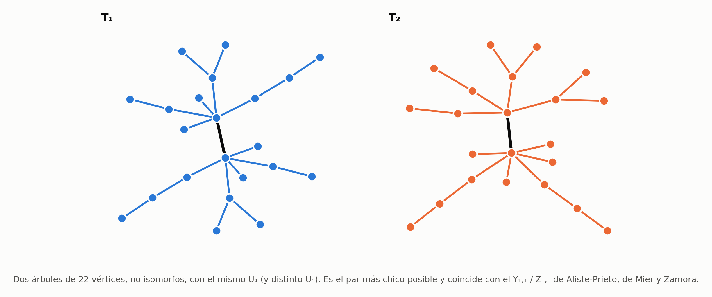
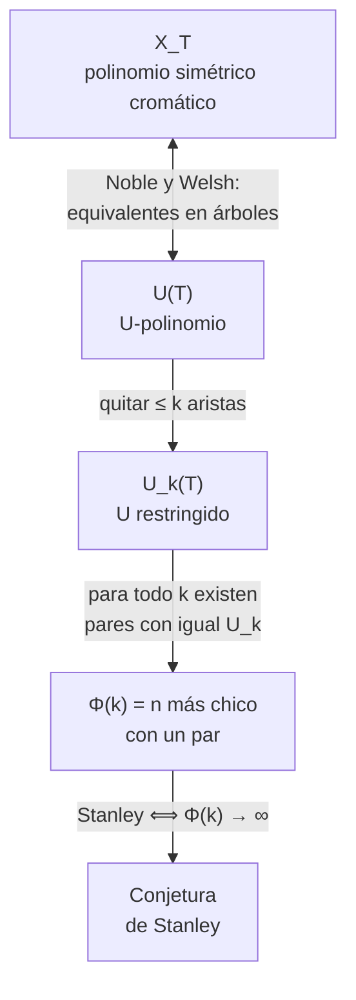
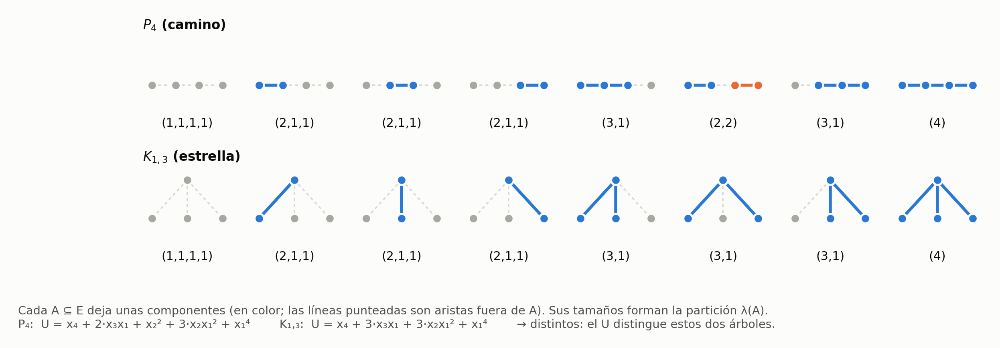
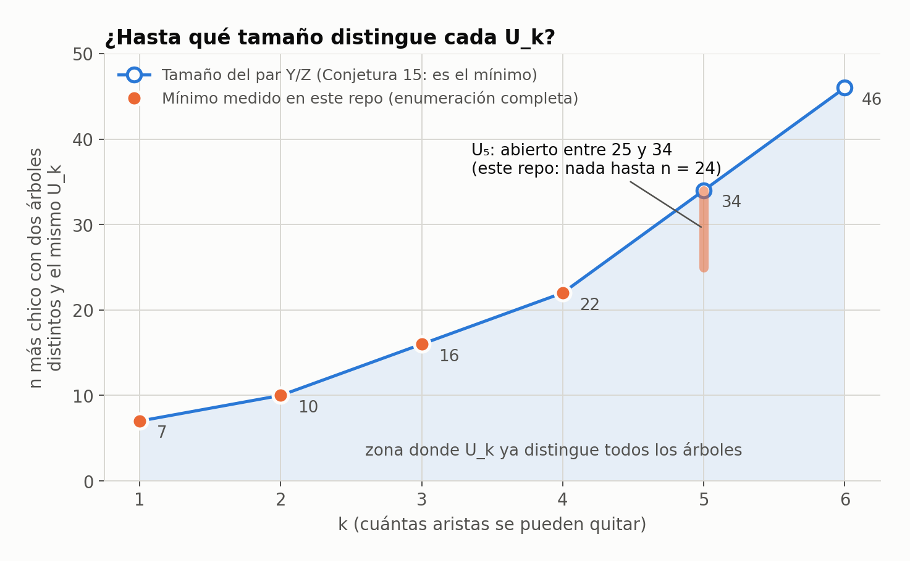
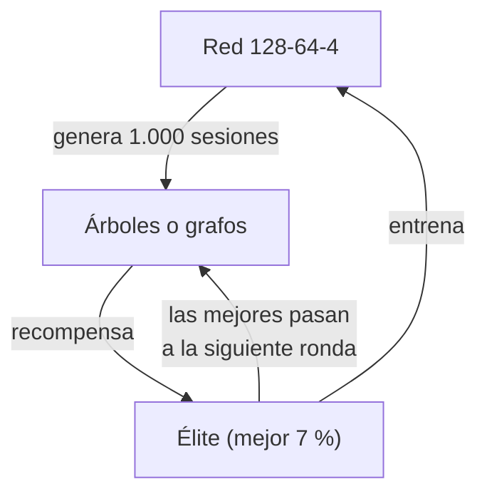
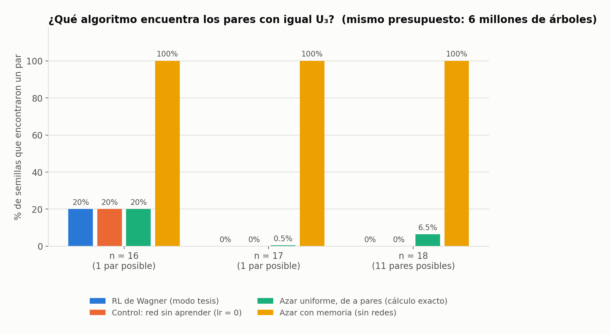

# RL contra la conjetura de Stanley (1995)

Tesis de Licenciatura en Matemáticas (UNAB). La pregunta es si el método de Wagner (aprendizaje reforzado con *Cross-Entropy*) encuentra dos árboles distintos con el mismo polinomio simétrico cromático.

<picture>
  <source media="(prefers-color-scheme: dark)" srcset="figuras/readme/par-u4-n22-oscuro.png">
  
</picture>

La **conjetura de Stanley** dice que el polinomio simétrico cromático $X_T$ distingue árboles: si $X_{T_1} = X_{T_2}$, entonces $T_1 \cong T_2$. Está verificada hasta 29 vértices y sigue abierta. Este repo replica la tesis con el mismo núcleo (el *Cross-Entropy* de Wagner, 2021) y la acelera. Además la mide contra la verdad: cuántos pares existen de verdad (enumerando **todos** los árboles hasta $n = 24$) y si aprender rinde más que no aprender.

## En una mirada

| | Pregunta | Resultado |
|---|---|---|
| **H1** | ¿Se reproduce a Wagner (conjetura 2.1, $N = 19$)? | **Sí**, con su ajuste (SGD, minilotes, selección con tope): llega a **+0,0804**, el máximo exacto. El modo de la tesis (Adam, sin tope) llega como mucho a −0,48 y muere por memoria cerca de la iteración 400. |
| **H2** | ¿Aprender ayuda a encontrar grafos con igual $X_G$? | **No en el modo de la tesis.** Con $N = 7$ (existen 106 pares), el que aprende encuentra 58, 37 y 15; la red sin aprender, 104, 101 y 77. |
| **H3** | ¿Encuentra pares de árboles que se sabe que existen ($U_3$, $n$ = 16–18)? | **No mejor que sin aprender:** 2/10, 0/10 y 0/10 semillas, contra 2/10, 0/10 y 0/10. Con 10 semillas esto solo descarta un efecto grande. |
| **H4** | ¿Llega al óptimo conocido ($N = 12$, $k = 3$)? | **Sí:** distancia mínima √6 en 3 de 3 semillas (verificado enumerando los 551 árboles). |
| **H5** | ¿Se queda pegado en el primer par? | **Sí:** la diversidad baja de ~64 a 1 entre las iteraciones 170 y 266, y después no aparece ningún par nuevo. |
| — | ¿Y el azar con memoria (sin redes)? | Encuentra **todos** los pares de $n$ = 16–18 en 10/10 semillas, de 1 a 25 s por semilla. |
| — | ¿Hay pares con igual $U_5$ hasta $n = 24$? | **No.** El par mínimo con igual $U_5$ está entre 25 y 34 vértices. |

> [!IMPORTANT]
> Todos los experimentos sobre Stanley corrieron en el **modo de la tesis** (Adam, selección sin tope). El ajuste de Wagner, que es el que sí reproduce su resultado, todavía no se prueba en Stanley. H2 y H3 refutan esa configuración, no el método. El detalle está en [`docs/hipotesis.md`](docs/hipotesis.md).

## Empezar

```bash
pip install -r requirements.txt
python -m pytest tests                                                       # 66 tests, sin redes neuronales
python scripts/verdad_terreno/colisiones.py arboles --n 10 16 --k 2 3        # pares que existen (segundos)
python scripts/verdad_terreno/azar_con_memoria.py . 101,102 azar.json        # azar con memoria, n = 16-18
python scripts/figuras_readme.py                                             # regenera las figuras de este README
```

Salida de `colisiones.py` (deja un JSON por caso en `resultados/verdad_terreno/`):

```
arboles n=10 k=2: 106 arboles | grupos con colision 1 | pares no isomorfos 1 | 1.5s
arboles n=10 k=3: 106 arboles | grupos con colision 0 | pares no isomorfos 0 | 0.1s
arboles n=16 k=2: 19320 arboles | grupos con colision 498 | pares no isomorfos 578 | 6.5s
arboles n=16 k=3: 19320 arboles | grupos con colision 1 | pares no isomorfos 1 | 4.9s
```

Los entrenamientos con redes se corren en Kaggle, no en el PC (ver [Desarrollo](#desarrollo)).

---

## Marco teórico



### 1. De colorear a cortar aristas

El polinomio de Stanley suma sobre las coloraciones propias $\kappa$ de los vértices:

$$X_G = \sum_{\kappa \text{ propia}} \prod_{v \in V} x_{\kappa(v)}.$$

El **U-polinomio** de Noble y Welsh (1999) recorre los subconjuntos de aristas $A \subseteq E$ y anota cómo quedan las componentes conexas:

$$U_G(\mathbf{x}, y) = \sum_{A \subseteq E} \mathbf{x}_{\lambda(A)}\,(y-1)^{|A| - r(A)},$$

donde $\lambda(A)$ es la partición de $n$ que forman los tamaños de las componentes. Los dos se relacionan por $X_G = (-1)^{n}\,U_G(x_i = -p_i,\ y = 0)$. En un **árbol** siempre $|A| = r(A)$, así que el signo desaparece: el U de un árbol solo cuenta qué particiones aparecen al quitar aristas.

<picture>
  <source media="(prefers-color-scheme: dark)" srcset="figuras/readme/u-polinomio-oscuro.png">
  
</picture>

En grafos con ciclos, $X_G$ no distingue: Stanley ya dio dos grafos distintos de 5 vértices con el mismo $X_G$. Enumerando todos los grafos conexos, este repo cuenta 1 par con $N = 5$, 9 con $N = 6$ y 106 con $N = 7$. Es la verdad de terreno del Enfoque 1.

### 2. $U_k$: quitar a lo más $k$ aristas

El $U$ **restringido** $U_k$ (Aliste-Prieto, de Mier y Zamora, 2017) suma solo los cortes de a lo más $k$ aristas. Es el «U truncado» de la tesis. Es mucho más barato: $\sum_{j \le k} \binom{n-1}{j}$ cortes en vez de $2^{n-1}$.

<picture>
  <source media="(prefers-color-scheme: dark)" srcset="figuras/readme/uk-cortes-oscuro.png">
  
</picture>

Cada nivel $j$ del vector suma $\binom{n-1}{j}$ en cualquier árbol. Por eso dos vectores distintos difieren en al menos dos coordenadas, y la menor distancia posible entre ellos es $\sqrt{2}$. Estar «a $\sqrt{2}$» no quiere decir estar cerca de un par.

### 3. ¿Hasta dónde distingue cada $U_k$?

Para **todo** $k$ hay árboles distintos con el mismo $U_k$, así que **un par con igual $U_k$ no es un contraejemplo a Stanley**. Lo que importa es $\Phi(k)$, el $n$ más chico donde aparece uno. Aliste-Prieto, de Mier y Zamora (2021, arXiv:2002.08186) construyen los pares $Y/Z$ (Teorema 12), que dan una cota superior. La Conjetura 15 dice que esa cota es exacta, y por la Prop. 16 eso implicaría Stanley. Lo que se puede atacar es $k = 5$: un par con igual $U_5$ y menos de 34 vértices tumba la Conjetura 15.

<picture>
  <source media="(prefers-color-scheme: dark)" srcset="figuras/readme/phi-k-oscuro.png">
  
</picture>

| $k$ | Primer $n$ con un par (medido aquí) | Par $Y/Z$ |
|---|---|---|
| 1 | 7 | 7 |
| 2 | 10 | 10 |
| 3 | 16 | 16 |
| 4 | 22 (es exactamente $Y_{1,1}/Z_{1,1}$) | 22 |
| 5 | ninguno hasta 24 | 34 |

<picture>
  <source media="(prefers-color-scheme: dark)" srcset="figuras/readme/pares-por-n-oscuro.png">
  
</picture>

### 4. El algoritmo que calcula $U_k$

`stanley_rl/upoly.py` (cambio 18 de [`CAMBIOS_VS_WAGNER.md`](CAMBIOS_VS_WAGNER.md)):

1. Calcula una vez el tamaño de cada subárbol, `sz[c]` (panel izquierdo de la figura del punto 2).
2. Recorre las combinaciones de cortes en profundidad. Cortar la arista sobre `c` crea una componente de tamaño `sz[c]` y le resta `sz[c]` a la componente que lo contenía. Cada corte cuesta O(1) y no se recalcula nada.
3. Traduce el multiconjunto de tamaños a su coordenada sin ordenar: suma un número aleatorio fijo de 64 bits por tamaño y busca la suma en una tabla hash. La tabla se construye comprobando que no haya choques, así que el vector es **exacto**.

Resultado: con $n = 34$ y $k = 5$ (284.274 cortes) baja de 42–61 ms a 3,6 ms por árbol (2,7 ms si basta el hash). Los tests lo comparan con la fuerza bruta y con los pares $Y/Z$ hasta $n = 34$. Para buscar pares se usa en cascada ($U_3 \to U_4 \to U_5$): el hash filtra y el vector exacto confirma.

---

## El método de Wagner



- **Enfoque 1 (grafos):** la red decide arista por arista. La recompensa es $1/(1+\mathrm{MSE})$ entre los dos vectores $U(x,0)$, y $-10^6$ si los grafos son isomorfos o alguno no es conexo.
- **Enfoque 2 (árboles):** cada sesión construye **un par**: el vértice $i$ elige a su padre entre $0, \dots, i-1$. La recompensa es $1/(1 + \lVert U_k(T_1) - U_k(T_2) \rVert_2)$, y $-10^6$ si los árboles son isomorfos.
- **Validación:** la conjetura 2.1 ($\lambda_1 + \mu \ge \sqrt{n-1} + 1$, que Wagner refutó con $N = 19$).

<picture>
  <source media="(prefers-color-scheme: dark)" srcset="figuras/readme/wagner-n19-oscuro.png">
  
</picture>

## ¿Qué algoritmo encuentra los pares de cada $k$?

Todos con el mismo presupuesto: 3.000 iteraciones × 1.000 sesiones × 2 árboles = 6 millones de árboles.

- **RL de Wagner (modo tesis):** el método de la tesis.
- **Control (red sin aprender, `lr = 0`):** el mismo algoritmo con los pesos congelados. Sirve de placebo: si el RL no le gana, lo que encuentra lo habría encontrado igual al azar.
- **Azar uniforme de a pares:** probabilidad exacta de sacar el par eligiendo los padres al azar.
- **Azar con memoria:** árboles sueltos al azar, comparando cada uno con **todo** el historial, no solo con su pareja. Por rapidez, el script reconoce los árboles de cada par con la verdad de terreno. Un detector a ciegas (hash contra el historial y confirmación con el vector exacto) da el mismo resultado, porque el choque aparece justo con el segundo árbol del par.

<picture>
  <source media="(prefers-color-scheme: dark)" srcset="figuras/readme/metodos-k3-oscuro.png">
  
</picture>

| | $k = 3$, $n \le 18$ | $k = 3$ y $4$, $n = 24$ | $k = 5$, $n$ de 25 a 33 |
|---|---|---|---|
| RL (modo tesis) | solo $n = 16$, en 2/10 semillas | 0 pares (existen 4.765 y 6) | sin probar |
| Azar con memoria | todos, 10/10 | sin probar | no alcanza: con $n = 33$ hay 3·10¹¹ árboles y 6 millones de muestras son el 0,002 % |
| Enumeración completa | todos | todos (64 min en 4 núcleos de Kaggle) | ~4,7·10¹¹ árboles en total: pendiente, en el NLHPC |

Con $n \le 18$ hay pocos árboles (123.867 con $n = 18$) y 6 millones de muestras son 48 veces esa cantidad, así que el azar con memoria tiene ventaja. La comparación justa a escala es con la enumeración. Aun así muestra que comparar solo los dos árboles de cada sesión limita al Enfoque 2.

### Por qué falla: la población colapsa

<picture>
  <source media="(prefers-color-scheme: dark)" srcset="figuras/readme/colapso-oscuro.png">
  
</picture>

Cuando encuentra un par, su recompensa vale 1,0. La red aprende a repetirlo hasta que toda la élite es el mismo par, y deja de explorar.

## Comparación con la presentación de la tesis

| Lámina | Presentación | Réplica |
|---|---|---|
| Wagner, $N = 19$ | −0,48 | modo tesis: −0,4803 (igual); ajuste de Wagner: **+0,0804** |
| Grafos, $N$ = 6 y 7 | un par por $N$ | los dos pares son correctos (están en la verdad de terreno); aquí el que aprende encuentra de 7 a 9 de los 9 pares ($N = 6$) y de 15 a 58 de los 106 ($N = 7$) |
| Árboles, $N = 12$, $k = 3$ | par a distancia 16,6 | √6 ≈ 2,449, el mínimo exacto |
| Árboles, $N = 24$ | par a distancia 236,6 ($U_3$) y 669,7 ($U_4$) | 15,7 y 19,2 aprendiendo, 7,6 y 28,5 en el control; ninguno llega a un par, aunque existen 4.765 ($U_3$) y 6 ($U_4$) |

Detalle en [`resultados/comparacion_presentacion.txt`](resultados/comparacion_presentacion.txt).

## Lo que viene

- [ ] H3 con el ajuste de Wagner y reinicio cuando la población colapsa (30 semillas, $n$ = 18–20)
- [ ] «Wagner con memoria»: una sesión = un árbol, recompensa = cercanía al árbol más parecido del historial
- [ ] Líneas base de la literatura: búsqueda tabú, recocido simulado y NRPA
- [ ] Medir sin redes si una distancia $U_k$ chica acerca a un par
- [ ] Enumeración de $U_5$ con $n$ de 25 a 33 en el NLHPC (piloto con $n$ = 25–28)
- [ ] Atajo con árboles de dos centroides y tablas de mitades
- [ ] Explicar la diferencia con Smith–Smith–Tian en $n = 23$

La revisión de literatura y el plan completo están en [`docs/literatura_alternativas.md`](docs/literatura_alternativas.md) y [`docs/hipotesis.md`](docs/hipotesis.md).

## Desarrollo

```bash
python -m pytest tests                          # 66 tests
python kaggle/lanzar.py --lote humo             # prueba corta en Kaggle (CLI autenticada)
python kaggle/bajar.py --lote humo              # baja la salida a resultados/kaggle/humo/
```

Los kernels de Kaggle clonan este repo en un commit fijo, que queda guardado en cada `estado.json`.

```
stanley_rl/          # Enfoques 1 y 2, U-polinomio (Numba), red y Cross-Entropy
tests/               # 66 tests, sin redes
scripts/             # verdad de terreno, azar con memoria, figuras, validación de Wagner
kaggle/              # lanzar y bajar lotes
resultados/          # verdad de terreno y salidas de Kaggle (sin los modelo.pt)
docs/                # hipótesis, literatura y notas
BITACORA.md          # qué se hizo cada día
CAMBIOS_VS_WAGNER.md # cada diferencia con el código de Wagner, numerada
wagner_original/     # copia sin modificar del repo de Wagner, para comparar
```

## Gracias y referencias

- Código original del método: [zawagner22/cross-entropy-for-combinatorics](https://github.com/zawagner22/cross-entropy-for-combinatorics) (copia en `wagner_original/`, ver su `PROCEDENCIA.md`).
- R. P. Stanley, *A symmetric function generalization of the chromatic polynomial of a graph*, Adv. Math. 111 (1995).
- S. D. Noble y D. J. A. Welsh, *A weighted graph polynomial from chromatic invariants of knots*, Ann. Inst. Fourier 49 (1999).
- J. Aliste-Prieto, A. de Mier y J. Zamora, *On trees with the same restricted U-polynomial and the Prouhet–Tarry–Escott problem*, Discrete Math. 340 (2017), arXiv:1509.09210.
- J. Aliste-Prieto, A. de Mier y J. Zamora, *On the smallest trees with the same restricted U-polynomial and the rooted U-polynomial*, Discrete Math. 344 (2021), arXiv:2002.08186.
- I. Smith, Z. Smith y P. Tian, *Symmetric chromatic polynomial of trees*, arXiv:1505.01889.
- S. Heil y C. Ji, *On an algorithm for comparing the chromatic symmetric functions of trees*, Australas. J. Combin. 75 (2019), arXiv:1801.07363.
- A. Z. Wagner, *Constructions in combinatorics via neural networks*, arXiv:2104.14516 (2021).
- A. Mehrabian et al., *Finding increasingly large extremal graphs with AlphaZero and tabu search*, IJCAI 2024, arXiv:2311.03583.
